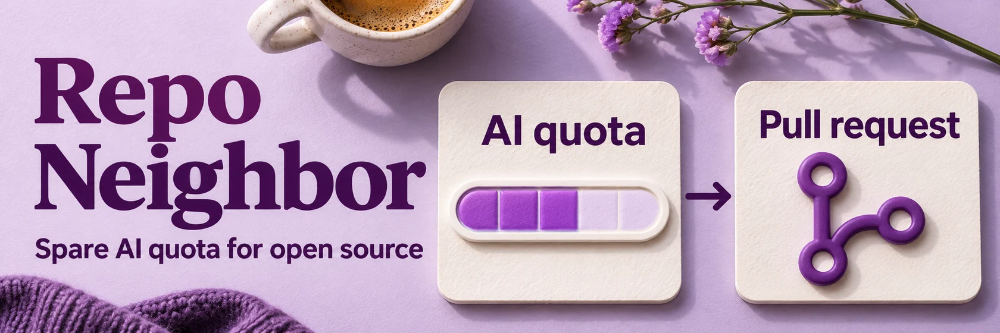
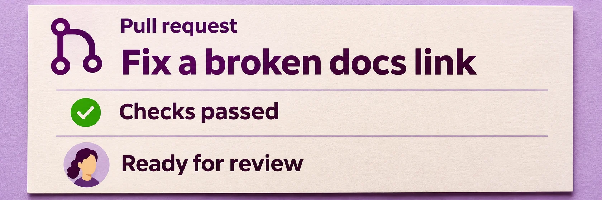

**English** · [Русский](docs/ru.md) · [Español](docs/es.md) · [Deutsch](docs/de.md) · [Français](docs/fr.md) · [Português](docs/pt.md) · [简体中文](docs/zh.md) · [日本語](docs/ja.md) · [Українська](docs/uk.md)

# Repo Neighbor

Have an hour left on your AI plan? Give your coding agent one open-source issue. You set the time budget, review the patch and decide when to send it. The community picks projects each week.

**[Pick a task](campaigns/README.md)** · **[Nominate a project](docs/maintainers.md)** · **[See community results](campaigns/reports/README.md)**

## Find your first issue

With Python 3.8+ and an authenticated GitHub CLI, run this from your terminal:

```sh
git clone https://github.com/TONstories/repo-neighbor.git
cd repo-neighbor
python3 skills/repo-neighbor/scripts/quota.py find --language Python --limit 3
```

The finder reads public GitHub issues and shows up to three candidates with evidence about the language, scope and checks. Change `Python` to the language you want. Discovery makes no model calls. [Supported stacks](docs/stacks.md)



For a coordinated session, reserve your issue on the weekly board and wait for confirmation. Give your agent the issue link and a time box. For example:

> I have 45 minutes. Use Repo Neighbor to fix one documentation issue. Keep the last 10 minutes for checks. Show me the diff and PR description before posting.

## Connect your agent

| | Agent instructions |
|---|---|
| Terminal | [Codex](agents/codex.md) · [Claude Code](agents/claude.md) · [Gemini CLI](agents/gemini.md) · [Aider](agents/aider.md) · [OpenCode](agents/opencode.md) |
| Editor | [Cursor](agents/cursor.md) · [GitHub Copilot](agents/copilot.md) · [Cline](agents/cline.md) · [Continue](agents/continue.md) |
| Other clients | [Goose](agents/goose.md) · [Mistral Vibe](agents/vibe.md) · [Qwen Code](agents/qwen-code.md) |

**Before your Codex quota resets.** Check the actual allowance or opt into a foreground watch. You choose the reserve and the issue. The watch can prepare one local documentation draft. [Pre-reset setup](docs/reset-window.md)

<details>
<summary>Search filters, portable briefs and local models</summary>

Filter by repository with `--repo owner/name`, or use `--json` for scored results. The finder checks invitation labels, recent activity, project policy, file references and review capacity. Verify the scope in the target project.

```sh
python3 skills/repo-neighbor/scripts/quota.py find --language Python --language TypeScript --minutes 90 --reserve 15 --kind tests --json
python3 skills/repo-neighbor/scripts/quota.py brief ISSUE_URL --minutes 90 --reserve 15 > brief.md
python3 skills/repo-neighbor/scripts/quota.py brief ISSUE_URL --runtime ollama --model LOCAL_MODEL_ID
```

Replace the issue URL and model ID. Use `--runtime lmstudio` for LM Studio. Read the project's instructions and AI policy before touching its code. [Client compatibility](docs/compatibility.md)

</details>

## Open a pull request

Use the target project's template, link the issue and list the checks you actually ran. Include this visible paragraph in every PR initiated through Repo Neighbor:

> I chose to make this contribution because [Repo Neighbor](https://github.com/TONstories/repo-neighbor) prompted me to work on this issue.

Validate your final body with `python3 skills/repo-neighbor/scripts/quota.py check-pr pr-body.md`. If project policy rules out the attribution, choose a different task. [PR template](templates/contribution.md)

## Run a community week

Members nominate and vote on repositories. Each member starts with one vote and earns more through distinct tasks accepted upstream. Weekly reports link the original proposal to its PRs and estimated engineering value. Members can also contribute capped inference or share a scientific computation across computers.

[Voting rules](docs/community.md) · [Project allocation and volunteer computing](docs/allocation.md) · [Task reservations and handoffs](campaigns/guide.md) · [Sponsor inference](sponsorship/README.md)

[Contribute](CONTRIBUTING.md) · [Design decisions](docs/research.md) · [MIT license](LICENSE)
