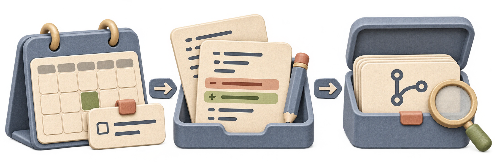

# Participation · Участие · Participación

[Current selection](README.md) · [Archive](archive) · [Editor](editor.json) · [Receipts](ledger.json)



| English | Русский | Español |
| --- | --- | --- |
| Choose a task on the current board. Click **Reserve**, adjust the session length in minutes in the issue title, and submit it here. | Выберите задачу в выпуске, нажмите **Забронировать**, укажите длительность сессии в минутах в заголовке и создайте issue здесь. | Elige una tarea, pulsa **Reservar**, ajusta los minutos en el título y abre la incidencia aquí. |
| Look up your request number in the receipt ledger. Start after confirmation. One active reservation per person. | Найдите номер своего запроса в журнале. Начните после подтверждения. У одного человека одна активная бронь. | Busca el número de tu solicitud en el registro. Empieza tras la confirmación. Una reserva activa por persona. |
| A reservation expires one hour after your time box, capped at 24 hours. Release early or record your PR before expiry. | Бронь истекает через час после сессии, максимум через 24 часа. Освободите ее раньше или привяжите свой PR до истечения. | La reserva vence una hora después de la sesión, con un máximo de 24 horas. Libérala o registra tu PR antes del vencimiento. |
| Follow the upstream project's AI and assignment rules. Check the discussion again before editing. | Соблюдайте правила проекта по ИИ и назначению исполнителей. Перед правкой проверьте обсуждение. | Respeta las reglas sobre IA y asignaciones del proyecto. Revisa la conversación antes de editar. |

Create an issue **in Repo Neighbor** with one of these exact title formats. Replace the URLs and minutes. GitHub supplies the requester identity. Only the holder can release or submit. Include the source issue URL and mandatory attribution in the PR body. Results are recorded by command issue number; the workflow closes processed requests. A failed run leaves requests available for reconciliation.

```text
rn claim https://github.com/OWNER/PROJECT/issues/123 90
rn release https://github.com/OWNER/PROJECT/issues/123
rn submit https://github.com/OWNER/PROJECT/issues/123 https://github.com/OWNER/PROJECT/pull/456
```

## How a week works

For selection and new reservations, a project needs at least 100 GitHub stars and a verified maintainer approval on an open or merged PR in the past 72 hours. The current board drops projects that no longer qualify and fills available places from the eligible pool. Existing reservations and tracked PRs retain their original history. [Selection and roadmap](../docs/roadmap.md)

Weekly `discovery_seeds` in [the editor file](editor.json) extend the GitHub search. Seeded projects go through the same eligibility, workload and review checks as search results. Seeds carry no voting weight.

When a task lists an upstream prerequisite, confirm it with the project before starting. The board shows the prerequisite and directs contributors to the project's own coordination process. These tasks do not count towards the two reservable tasks needed for a new project. The GitHub reservation command reports the same prerequisites if a card changed after the board was published.

An `exclude` entry in the editor file removes a repository from the active board and from new selection. Use the weekly `exclude` list for a single campaign. Earlier selections and existing reservation records stay in the archive and ledger.

Each selection round records the status and coverage limits of its GitHub issue searches in `audit.json`. A partial search can still yield candidates that pass the project and review capacity checks. An unverified review queue supplies no capacity for new projects. A GitHub rate limit interrupts selection so the existing board can be retried from the next run.

If the bounded approval search cannot verify a selected project, the board hides that project's cards and keeps its allocation for the next recheck. The audit lists affected projects. A nomination or reservation encountering the same limit receives a verification message.

Monday at 09:15 Moscow time is the intended release. GitHub can delay scheduled jobs. Each new project needs at least two distinct tasks. We compare mentioned file paths and similar titles; the contributor must confirm the change is independent. A repository without sufficient review bandwidth waits. External PR decisions over the last 28 days set the weekly limit: round up decisions/4, clamp to 1–5, subtract current open external PRs and unsubmitted active reservations. Owner/member/collaborator PRs and recognized bot accounts are excluded. A bounded review sample with incomplete coverage yields zero slots. An open submitted PR counts only through the upstream queue. Results follow the original week after merge. The board is a snapshot; command processing checks live eligibility. The additional reconciliation runs every six hours.

## Community allocation / Распределение / Selección

[Rules, capacity, priorities and volunteer computing](../docs/allocation.md)

### Передача незавершенной работы / Handoff / Relevo

Откройте issue в Repo Neighbor с заголовком `rn handoff ISSUE_URL`. В теле укажите три строки:

1. Публичная ссылка на ветку, коммит или draft PR с вашей работой.
2. Какие проверки выполнены и с каким результатом. Если не запускали, укажите это.
3. Что именно должен сделать следующий участник.

Последний владелец брони может передать задачу и после истечения времени, пока ее не взял другой участник. Доска и квитанция следующей брони ведут на эти заметки. Пишите только публичные сведения.

**EN** — Open an issue titled `rn handoff ISSUE_URL`. Use three body lines for the public branch/commit/draft PR URL, checks and results, and the next step.
**ES** — Abre un issue con el titulo `rn handoff ISSUE_URL`. Escribe tres lineas con el enlace publico a la rama, commit o PR, las pruebas y su resultado, y el proximo paso.

### Проверки открытых PR / Open PR checks

`campaign/journey.py --live --as-of TIMESTAMP` при заполненном `--supplement` добавляет к открытым PR ожидающие проверки и проверки, требующие внимания. У снимка проверок есть свое время чтения и SHA коммита. Старые снимки могут не содержать этих данных.

**EN** — A live journey report with `--as-of` shows pending checks and checks that need attention for open PRs. The report records the observation time and head commit for those checks.

### Отзыв после merge / Outcome feedback / Resultado

GitHub-пользователь, который влил PR, или владелец персонального репозитория может открыть issue с заголовком `rn feedback PR_URL`. Пример тела: `solved 120 20`. Первое поле — результат (solved, partial, unresolved), второе — оценка минут работы, которую заменило изменение, третье — минуты ревью. Указывайте целые числа от 0 до 99999. Повторная команда обновляет отзыв. Результат появится в отчете недели, когда задачу забронировали, рядом с заявкой и PR. Расчетная стоимость и вес голосов сохраняют прежнюю методику.

**EN** — After merge, the merger or personal repository owner can submit `rn feedback PR_URL` with `solved|partial|unresolved saved_minutes review_minutes`. A newer report replaces the previous one.
**ES** — Despues de integrar el PR, quien lo integro o el propietario del repositorio personal puede enviar `rn feedback PR_URL` con el resultado y dos cifras en minutos (trabajo ahorrado y revision).
