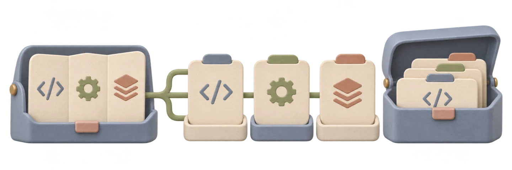

# Community rules · Правила сообщества · Reglas

[Maintainer proposal / Заявка владельца / Propuesta](maintainers.md)

[Live desk: nominate, vote, claim and see results](../campaigns/reports/README.md)

| Goal | Command in a new issue title in Repo Neighbor |
| --- | --- |
| Nominate a public repository as a community member | `rn nominate OWNER/REPO` |
| Submit a roadmap as a maintainer | [Verified maintainer proposal](maintainers.md) |
| Cast your whole ballot or change your choice | `rn vote OWNER/REPO` |
| Reserve one work package for 90 minutes | `rn claim ISSUE_URL 90` |
| Hand back unfinished work | `rn release ISSUE_URL` |
| Record your PR for review and impact accounting | `rn submit ISSUE_URL PR_URL` |

**Русский.** Один участник может выдвинуть один проект и отдать весь вес одному кандидату. С недели 2026-W49 вес равен `1 + ⌊√N⌋`, где `N` — число уникальных задач, принятых до открытия голосования. До закрытия можно заменить выбор. Окно длится с понедельника 09:15 по Москве до следующего понедельника 09:15. Донаты не увеличивают вес.

**English.** From the 2026-W49 campaign, ballot weight is one plus the integer square root of distinct tasks credited before the ballot opened. Each account has one replaceable ballot. Ties favor the earlier nomination, then repository name. Remaining places follow the [allocation rules](allocation.md).

**Español.** Desde la semana 2026-W49, el peso de cada cuenta es uno más la raíz cuadrada entera del número de tareas distintas aceptadas antes de abrir la votación. Se puede cambiar el voto hasta el cierre.

### Вклад с телефона / Mobile contributions / Contribuciones móviles

Независимая приемка перевода до открытия раунда также дает автору один зачет. Если тот же перевод вошел в PR по той же задаче, зачет остается один. Координатор указывает исходную задачу и автора в PR. В денежной оценке учитываются только принятые исходным проектом PR с известной оценкой.

An independently accepted desk task adds one credit before the next ballot opens. Set its canonical issue in the task catalog to link later PRs to the same work. Receipts preserve the original contributor. Each new ballot records the credited tasks. Replay the weekly allocation offline with `campaign/verify-week YYYY-Www`. Contest an input by opening an issue with the week, task and proposed correction.

Una traducción aceptada por otra persona aporta un crédito. La misma tarea conserva un único crédito cuando se integra en un PR. La valoración en dólares se calcula al incorporar el PR al proyecto de origen.

## Divide a goal into reviewable work

Use a project-week as the shared goal and upstream issue URLs as work-package IDs. For a larger issue the finder inspects GitHub sub-issues; it offers eligible open children instead of assigning the parent to several people. Each child has its own owner, scope, acceptance criteria and PR. For projects asking for one atomic PR, keep the issue with one contributor. Active claims and open reviews block duplicate tasks and known file overlaps; an expired reservation frees capacity. Coordinate unlisted file overlap with the maintainer before editing.

The browser and Codex CLI reserve pilot translations in the same desk. GitHub issue commands also check that desk before confirming a reservation. One active hold per participant and at most three reserved or awaiting-review tasks per project apply across entry points. The maintainer can request a smaller limit for upstream work. The public GitHub ledger records only campaign actions and review metadata.

Editors can declare ordering in the week's `requires` map in [editor.json](../campaigns/editor.json). Keys are task URLs, values are prerequisite task URLs. A dependent task can be claimed after those prerequisites have a registered merged PR. Keep dependencies acyclic. The live desk lists active owners, blockers, available work and next week's candidates.

## Measuring engineering value in USD

At reservation time Repo Neighbor freezes the issue's estimated minutes. At verified merge it counts the PR once. The pilot uses a transparent **$60 per engineering hour assumption**. A 30–90 minute task contributes **$30–$90** estimated replacement value. Unpriced work is reported separately. Self-reported hours, lines changed, API donations and open PRs produce no accepted dollar value. A heavy rewrite still needs human review of this coarse estimate.

Daily reports use Moscow calendar days. Weekly reports use the campaign boundary above and attribute merges by the upstream merge timestamp. A new participant is a person receiving their first confirmed reservation. Reports show actual submitted and merged PRs, vote weights, the estimated range and separately published sponsored inference charges. Real payroll savings would require the project's counterfactual budget and review costs.

### Local work before a PR

A contributor can document triage, a verification brief or a tested local patch even when the project closes the issue independently. Propose a receipt in [local-work.json](../campaigns/local-work.json) with the GitHub login, issue URL, timestamp, stage, short factual result and SHA-256 of the reviewed artifact. Keep private session logs and credentials on the contributor's machine. The daily and weekly reports count the contributor on their first recorded activity and list the stage reached. Re-running the same stage on the same issue preserves one receipt. Merged PRs, accepted desk submissions, vote credits and USD estimates retain their existing evidence requirements.
