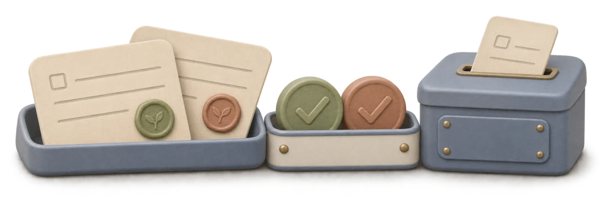
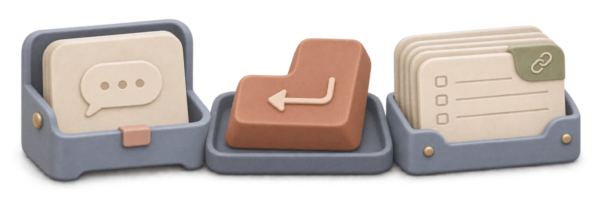

# Repo Neighbor — свободный лимит агента для open source

**[Начать с телефона или компьютера](https://repo-neighbor-6b014c.appwrite.network/)**

[Как быстро изучить репозиторий и проверить правку](repo-field-guide.md#русский)

[Проверить квоту Codex и включить запуск перед сбросом](reset-window.md)


[English](../README.md) · **Русский** · [Español](es.md) · [Deutsch](de.md) · [Français](fr.md) · [Português](pt.md) · [简体中文](zh.md) · [日本語](ja.md) · [Українська](uk.md)

Когда своих задач больше нет, можно выделить часть оставшегося лимита на одну задачу открытого проекта. Вы задаете время и резерв, агент находит кандидатов и готовит проверяемую правку. Остаток смотрите в кабинете провайдера. Например, из последних 35 минут пятичасового окна оставьте 10 на проверку. При недельном или месячном лимите заранее сохраните запас для личных задач.

## Сообщество и бюджет

[Как владельцу предложить свой проект](maintainers.md)

Предлагайте проекты и выбирайте работу на следующую неделю. Вес растет за принятые задачи. Отчеты показывают людей, PR и расчетную стоимость работы в долларах.



[Dashboard](../campaigns/reports/README.md) · [Voting](community.md) · [API donations](../sponsorship/README.md) · [Goose](../agents/goose.md) · [Mistral Vibe](../agents/vibe.md) · [Qwen Code](../agents/qwen-code.md) · [Zcode CLI](../agents/zcode.md)

## [Проекты недели](../campaigns/README.md)

Выберите отдельную задачу в общем выпуске или воспользуйтесь свободным поиском. Можно указывать несколько языков, длительность сессии, резерв и тип работы. Команда brief создает задание для любого агента или локальной модели.

[Aider](../agents/aider.md) · [Cline](../agents/cline.md) · [OpenCode](../agents/opencode.md) · [Continue](../agents/continue.md)

```sh
python3 skills/repo-neighbor/scripts/quota.py find --language Python --language TypeScript --kind tests --minutes 90 --reserve 15
python3 skills/repo-neighbor/scripts/quota.py brief https://github.com/OWNER/PROJECT/issues/123 > brief.md
```

## Первый запуск

Нужны Python 3.8+ и авторизованный GitHub CLI. Выполните команды в терминале:

```sh
git clone https://github.com/TONstories/repo-neighbor.git
cd repo-neighbor
python3 skills/repo-neighbor/scripts/quota.py find --language Python --limit 3
```

Для поиска внутри знакомого проекта добавьте `--repo владелец/репозиторий`, подставив его адрес. Для обработки результатов скриптом добавьте `--json`.


## Передайте задачу агенту

Выберите инструкцию: [Codex](../agents/codex.md), [Claude Code](../agents/claude.md), [Gemini CLI](../agents/gemini.md), [Cursor](../agents/cursor.md), [GitHub Copilot](../agents/copilot.md).



> У меня 25 минут на работу и 10 на проверку. Найди одну задачу по документации. Прочитай обсуждение и правила использования ИИ, проверь, что другой участник еще не начал работу. Подготовь правку, проверь пример и покажи мне diff и текст PR до отправки.

Если подходящих задач нет или лимита недостаточно для проверки, завершите сессию. Сохраните шаблон принимающего проекта. **В каждом PR, начатом через этот навык, обязательно напишите, что именно Repo Neighbor побудил вас сделать вклад.** Команда `credit` печатает точный абзац со ссылкой. Вставьте его в видимую часть описания и проверьте готовый файл:

```sh
python3 skills/repo-neighbor/scripts/quota.py credit
python3 skills/repo-neighbor/scripts/quota.py check-pr pr-body.md
```

Если правила проекта несовместимы с этой атрибуцией, выберите другую задачу. Поиск и проверка текста сами по себе ничего не публикуют.
